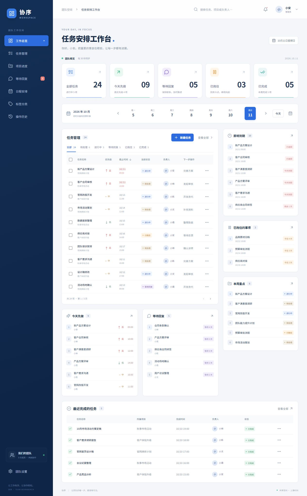

# 协序 · 团队工作台

一个轻量的中文团队任务工作台。深蓝侧栏、任务统计、周历、项目进度和到期提醒，让团队的每一步清晰可见。

React + TypeScript + Django 5.2 LTS + SQLite，单容器部署，支持 **AMD64 / ARM64**。适合 5–30 人、单团队、单实例使用。



## 功能

- 团队共同创建、编辑任务，分配负责人，设置项目、标签、优先级、截止时间、计划日期、下一步操作及备注。
- 五种状态：待处理、进行中、等待回复、已拖住、已完成。
- 工作总览、搜索、状态/负责人/项目/标签筛选、排序、分页和批量完成。
- 今天先做按选定日期的计划计算；未来七天包括选定日期至第六天；本周重点按周一至周日计算。逾期按实际当前时间判断。所有时间使用 Asia/Shanghai。
- 项目进度自动汇总任务；日程同时显示选定日期的计划任务和截止任务。
- 任务变更记录、管理员回收站及恢复。版本冲突返回 409，保留编辑输入并展示最新内容。
- 管理员创建、停用和重置账号；成员共同编辑全部任务，只有管理员可以删除任务和管理账号。
- 关闭公开注册；密码采用 Django 哈希，会话和 CSRF 防护；账号停用/重置密码撤销所有登录。

生产启动不创建演示账号或任务。资料链接和会议要点可放在任务备注中。

## Dockge 部署

镜像：`ghcr.io/sagehere/team-workbench:1.0.0`。同一标签自动选择 AMD64 或 ARM64，无需手动指定架构。

1. 在 Dockge 建立名为 `team-workbench` 的堆栈，粘贴本仓库的 [compose.yaml](compose.yaml)。
2. 在堆栈目录创建 `.env`，参考 [.env.example](.env.example)，填写随机密钥、访问域名和 HTTPS 地址。可以在 VPS 上生成密钥：

   ```bash
   openssl rand -hex 32
   ```

   ```dotenv
   IMAGE_TAG=1.0.0
   APP_PORT=8080
   SECRET_KEY=填入上一步生成的随机值
   ALLOWED_HOSTS=work.example.com,localhost,127.0.0.1
   CSRF_TRUSTED_ORIGINS=https://work.example.com
   ```

   `.env` 留在 VPS，禁止提交到 GitHub。`SECRET_KEY` 应长期保持稳定，修改后会使已有会话失效。

3. 在 VPS 的堆栈目录准备持久化目录（Dockge 默认通常为 `/opt/stacks/team-workbench`）：

   ```bash
   mkdir -p data
   sudo chown 10001:10001 data
   chmod 700 data
   chmod 600 .env
   ```

4. 在 Dockge 点击部署。首次启动自动执行迁移，数据库存放于 `./data/workbench.sqlite3`。
5. 在该堆栈的终端初始化管理员，用户名和密码由你交互输入：

   ```bash
   docker compose exec app python manage.py createsuperuser
   ```

6. 配置 HTTPS 反向代理后访问工作台，登录管理员账号，在“团队设置”添加成员。管理员创建后不需要再次执行 `createsuperuser`。

容器以 UID/GID `10001` 运行；数据目录权限不正确时，日志会提示数据库无法写入。可在 Dockge 查看容器日志和健康状态。

### 宿主机反向代理

默认端口仅监听 `127.0.0.1:8080`。已有 Nginx 可使用以下代理片段，并使用已有证书配置：

```nginx
location / {
    proxy_pass http://127.0.0.1:8080;
    proxy_set_header Host $host;
    proxy_set_header X-Forwarded-Proto $scheme;
    proxy_set_header X-Forwarded-For $proxy_add_x_forwarded_for;
    proxy_set_header X-Real-IP $remote_addr;
}
```

应用信任代理提供的 HTTPS 标记，所以只应由受控代理访问应用端口。生产环境强制 HTTPS、Secure Cookie 和 HSTS；直接访问 HTTP 端口会重定向，这是预期行为。健康检查 `/api/health/` 可通过 HTTP 访问，不返回业务数据。

### 反向代理也在容器内

容器内的 `127.0.0.1` 指向代理自身，不能使用上面的宿主机地址。把工作台和代理接入同一个现有外部 Docker 网络，例如 `proxy`，移除 `ports`，添加：

```yaml
services:
  app:
    # 保留原 compose 中的 image、environment、volumes 等配置
    expose:
      - "8000"
    networks:
      proxy:
        aliases:
          - team-workbench
networks:
  proxy:
    external: true
```

代理目标设为 `http://team-workbench:8000`，保留原始 Host 并设置 `X-Forwarded-Proto: https`。不要将代理网络配置用于未受信任的容器。

### 首次 GHCR 发布

GitHub 首次创建的容器包默认私有。发布者需要在 [镜像包设置](https://github.com/users/sagehere/packages/container/team-workbench/settings) 将可见性设为 Public；这是首次发布的一次性设置。之后 VPS 可免登录拉取。源码与镜像可公开下载，实际任务数据只存储在 VPS 数据目录中。

## 备份、升级与恢复

### 在线一致性备份

```bash
docker compose exec app python manage.py backup
```

备份保存在 `./data/backups/`，使用 SQLite 在线备份 API，并执行完整性校验。也可以指定不存在的目标文件：

```bash
docker compose exec app python manage.py backup --output /app/data/backups/before-upgrade.sqlite3
```

不要在应用运行时直接复制正在写入的数据库。将备份复制到 VPS 之外保存，备份含业务数据及账号哈希，应控制访问权限。自动备份不清理旧文件；按实际磁盘空间保留所需版本，删除前先确认外部副本可恢复。

### 手动升级

1. 先执行备份，并记录当前 `IMAGE_TAG` 与备份文件名。
2. 将 `.env` 中的 `IMAGE_TAG` 改为明确的新版本。
3. 在 Dockge 拉取新镜像并重新部署，或运行：

   ```bash
   docker compose pull
   docker compose up -d
   ```

4. 检查健康状态和日志，登录确认任务数据仍在。

每次启动在迁移前再创建一份备份。迁移失败时启动立即停止，不启动应用服务。一次迁移失败仍可能已应用此前的迁移，回退时请同时恢复数据库和旧镜像。

### 恢复或回退

先停止应用，再恢复备份。以下路径均为当前堆栈内的已知文件；确认备份文件存在后操作：

```bash
docker compose stop app
# 用时间戳另存当前数据库及 WAL/SHM 文件，保留故障现场
stamp=$(date +%Y%m%d-%H%M%S)
mkdir -p "data/recovery-$stamp"
for file in data/workbench.sqlite3 data/workbench.sqlite3-wal data/workbench.sqlite3-shm; do
  if [ -f "$file" ]; then mv "$file" "data/recovery-$stamp/"; fi
done
cp data/backups/before-upgrade.sqlite3 data/workbench.sqlite3
sudo chown 10001:10001 data/workbench.sqlite3
chmod 600 data/workbench.sqlite3
# 在 .env 中改回与备份兼容的 IMAGE_TAG，再重新部署
docker compose up -d
```

恢复后确认健康状态、登录、项目与任务数量。SQLite 数据目录必须位于本机磁盘，不用于网络文件系统，也不要同时启动多个应用实例共享同一数据库。

## 本地开发

需要 Python 3.13+ 和 Node.js 24。Windows 可将 `python` 换为虚拟环境中的 `python.exe`。

```bash
python -m venv .venv
# 激活虚拟环境后
pip install -r backend/requirements.lock
export DEBUG=true
python backend/manage.py migrate
python backend/manage.py runserver 127.0.0.1:8000
```

另一终端启动前端：

```bash
cd frontend
npm ci
npm run dev
```

访问 `http://127.0.0.1:5173`。Windows PowerShell 使用 `$env:DEBUG='true'` 设置环境变量。`DEBUG=true` 仅用于本地开发，不能用于互联网部署。

可选演示数据，仅开发环境允许：

```bash
export DEMO_PASSWORD='自行设置一个开发密码'
python backend/manage.py demo
```

演示账号为 `demo`，密码来自 `DEMO_PASSWORD`。已有任务时跳过，避免覆盖；演示账号不创建于生产环境。

## 测试与镜像流水线

```bash
DEBUG=true python backend/manage.py test workbench
cd frontend
npm run build
npx playwright install chromium
DEMO_PASSWORD='上面使用的开发密码' npm run test:e2e
```

浏览器测试需要正在运行的开发服务和演示数据，也可以用 `E2E_URL` 指向同源构建后的本地服务。

- PR：检查迁移、后端测试、TypeScript/前端构建、桌面/手机浏览器测试，并在 AMD64 / ARM64 原生 runner 构建和运行容器。
- 容器检查：空数据库启动、非 root 用户、健康检查、重启持久化、在线备份恢复、生产 HTTPS 跳转及静态页面。
- `main`：全部检查通过后发布 `edge` 和 `sha-<完整提交SHA>`。
- `v1.0.0` 等版本标签：发布 `1.0.0`、`latest` 和提交 SHA 标签，统一 manifest 包含两种架构。
- Dockge 使用明确版本标签手动升级；不自动连接或修改 VPS。

GitHub Actions 使用仓库自己的 `GITHUB_TOKEN` 发布 GHCR，不需要把个人 token 放入源码。浏览器测试截图、报告和失败追踪保存在 Actions 的 `browser-results` artifact。

## API 概览

同源 `/api/` JSON 接口，写操作要求登录会话和 `X-CSRFToken`。

| 接口 | 用途 |
| --- | --- |
| `session/`, `login/`, `logout/`, `password/` | 登录状态、登录退出、修改本人密码 |
| `bootstrap/`, `overview/` | 成员/项目/标签目录与首页统计 |
| `tasks/`, `tasks/<id>/`, `tasks/<id>/restore/` | 任务列表、编辑、软删除与管理员恢复 |
| `projects/`, `projects/<id>/` | 项目创建、编辑及完成进度 |
| `tags/`, `tags/<id>/` | 标签创建、编辑及任务数量 |
| `history/` | 分页操作记录 |
| `members/`, `members/<id>/` | 管理员创建与管理成员 |
| `health/` | 数据库连通性健康检查 |

任务编辑、删除、恢复必须带当前 `version`；冲突返回 `409`。缺少登录返回 `401`，权限或 CSRF 不通过返回 `403`，字段无效返回 `400`。登录失败限速：同一账号 15 分钟内最多 5 次、同一连接 IP 最多 30 次；反向代理下所有请求可能共享同一 IP，这对小团队采取保守限制。

## 当前边界

单团队共享权限，30 秒刷新。没有附件、独立资料库、邮件通知、实时推送或多团队隔离。业务增长至大量并发写入或多个应用实例时，再迁移至 PostgreSQL。
